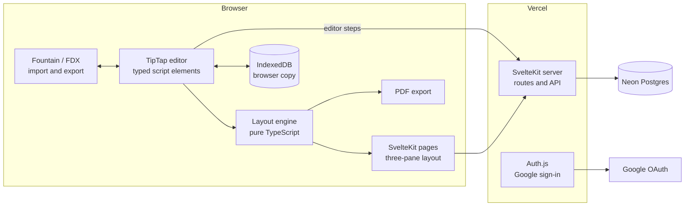

# Architecture

How Cold Open is put together. How each external service is connected, and its free-tier limits, are in [services.md](services.md).

## Components

- **Editor:** each paragraph is a script element node (scene heading, action, character, and so on) with its type stored on the node. The script type's definition decides which elements exist and how Enter and Tab move between them.
- **Script type definitions:** JSON checked against a schema. Built-in types ship with the app, and custom types are stored per user. The editor, the layout engine and export all read the same definition.
- **Layout engine:** a pure function from a script and its type definition to lines and pages. It uses a fixed grid: 12pt Courier Prime, 10 characters per inch, 6 lines per inch, on US Letter. It handles page breaks, (MORE) and (CONT'D), and dual dialogue. It has no browser or server dependencies, so it can be unit-tested in isolation. The page view and the PDF export both use it.
- **Saving:** edits are kept in IndexedDB first, then sent to the server as editor steps with the document version they apply to. The server accepts them only if the version matches, which prevents silent overwrites between two tabs. When the versions don't match, the writer is asked which copy to keep.
- **Server:** SvelteKit routes. Every database query goes through one access layer that requires the current user's project membership.

## Data model (first version)
| Table | Holds |
|---|---|
| `users` | Google account id, email, name |
| `projects` | Title, script type, title page fields, timestamps |
| `project_members` | Project, user, role (`owner` only for now) |
| `scripts` | Project, current document (ProseMirror JSON), version number |
| `script_types` | Custom type definitions (JSON), owner |
| `revisions` | Project, compressed snapshot, name (optional), automatic or named, created at |
| `notes`, `cards` | Project notes and beat board cards, with position and links to scenes |
| `character_notes`, `location_notes` | Notes about names found in the script |

Characters and locations themselves are taken from the script automatically and aren't stored separately.

## Environments
| | Local | Preview (`dev`) | Live (`main`) | Demo | CI |
|---|---|---|---|---|---|
| Code | Working copy | Last push to `dev` | Last merge to `main` | Same as live | The commit under test |
| Database | Neon `dev` branch (sandbox) | Neon `dev` branch (sandbox) | Neon `main` (real data) | Separate demo database | Throwaway Postgres in the CI runner |
| Badge | SANDBOX | SANDBOX | none | DEMO banner | n/a |
| Sign-in | Google (allow-list) | Google (allow-list) | Google (allow-list) | None ("Try it") | Test session |

A preview from any branch other than `dev` has no database setting, so it fails to start rather than reaching real data.
